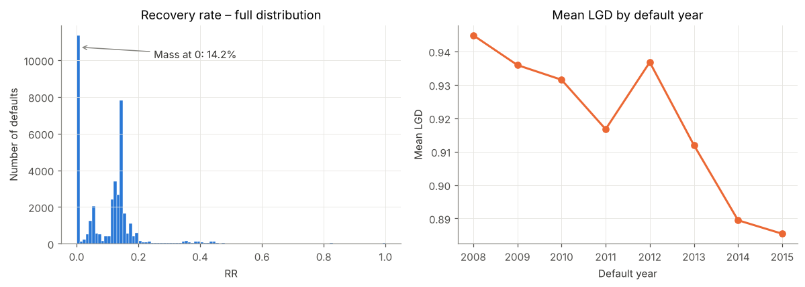
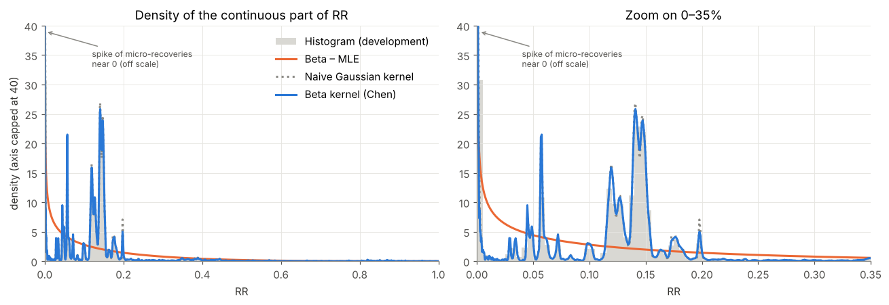
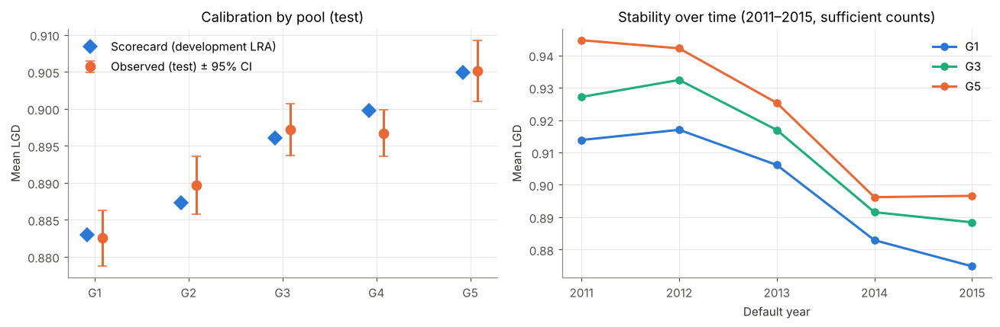
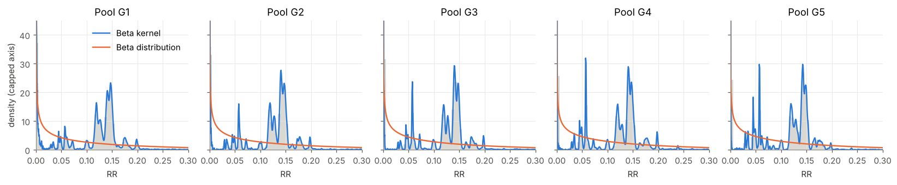

# LGD modelling: Beta distribution vs kernel smoothing vs expert-judgement scorecard

Estimation of **Loss Given Default (LGD)** on real recovery data, comparing:

- a **parametric approach**: fitting a Beta distribution (method of moments, maximum likelihood, zero-one-inflated Beta), plus a two-stage *logit + Beta regression* benchmark;
- a **non-parametric approach**: kernel estimation of the recovery-rate *density* on [0,1], with boundary-bias correction (reflection, logit transform, Chen's Beta kernel as in Renault & Scaillet, 2004);
- an **expert-judgement scorecard**: LGD pools built from economically motivated factors, calibrated to the long-run average with an illustrative margin of conservatism.

The full analysis is in [`notebooks/lgd_modelling.ipynb`](notebooks/lgd_modelling.ipynb) (executed, with outputs).

## Data

| | |
|---|---|
| Source | Kaggle – [All Lending Club loan data](https://www.kaggle.com/datasets/wordsforthewise/lending-club), file `accepted_2007_to_2018Q4.csv` (CC0) |
| Population | Unsecured US consumer loans charged off, originated 2007–2015 |
| Modelling sample | 58,057 defaults observed 2008–2015 (development 70% / test 30%) |
| Target | `RR = (recoveries − collection fees) / EAD`, `EAD = funded amount − principal repaid`, `LGD = 1 − RR` |

Defaults from 2016 onwards are excluded: the share of zero recoveries jumps from 20% to 68%, which signals workouts still open at the extraction date rather than genuine total losses.

The prepared sample is provided in `data/lgd_lendingclub_2007_2015.csv.gz` (152,348 charged-off loans, 8 MB). To rebuild it from the raw Kaggle file (1.6 GB, not included):

```bash
python src/extract_lgd_data.py accepted_2007_to_2018Q4.csv data/lgd_lendingclub_2007_2015.csv.gz
```

## Key results

**1. The recovery-rate distribution is mixed**: 14% of defaults have zero recovery, and the continuous part is multimodal (peaks near 5.7%, 12%, 14–15% and 20%), most likely driven by bulk debt-sale prices.



**2. The Beta distribution fits the mean but not the shape.** The inflated Beta reproduces the mean LGD (0.895 vs 0.894 observed), but boundary-corrected kernels clearly dominate out of sample:

| Estimator (test sample) | Mean log-likelihood | KS distance | Median LGD |
|---|---|---|---|
| Beta – maximum likelihood | 1.19 | 0.274 | 94.8% |
| Naive Gaussian kernel | 2.15 | 0.063 | 87.7% |
| Gaussian kernel on logit | 2.20 | 0.016 | 87.9% |
| **Beta kernel (Chen)** | **2.24** | **0.008** | **87.9%** |
| Empirical | – | – | 87.9% |



**3. The expert scorecard is monotonic and well calibrated out of sample** (LGD from 88.3% in G1 to 90.5% in G5, no significant observed-vs-estimated gap). The parametric benchmark ranks slightly better but shows a calibration bias and economically inconsistent coefficient signs caused by collinearity.

| Model (test sample) | RMSE | CAP Gini | Mean predicted LGD |
|---|---|---|---|
| Simple mean | 0.1113 | 0.00 | 0.8935 |
| Expert scorecard | 0.1111 | 0.08 | 0.8934 |
| Logit + Beta regression | 0.1108 | 0.13 | 0.8905 |

Discriminatory power is weak for both models, consistent with recoveries being largely pooled through debt sales.



**4. Combining both approaches**: the scorecard provides the segmentation and the Beta kernel provides the full within-pool distribution, yielding usable LGD quantiles by pool for stress testing or economic capital.



## Limitations

- **Undiscounted LGD**: Lending Club does not provide recovery cash-flow dates, whereas regulatory workout LGD discounts recoveries to the default date (EBA/GL/2017/16).
- Only direct collection fees are deducted; indirect workout costs are not allocated.
- US unsecured consumer loans sold to debt buyers: results are not transferable as such to collateralised European portfolios.
- The *downturn* section is illustrative only; a compliant calibration requires identifying downturn periods from macroeconomic indicators (EBA/GL/2019/03).

## Repository structure

```
lgd-modelling/
├── data/lgd_lendingclub_2007_2015.csv.gz   # prepared modelling sample
├── notebooks/lgd_modelling.ipynb           # full analysis (executed)
├── src/
│   ├── extract_lgd_data.py                 # builds the sample from the raw Kaggle file
│   ├── lgd_model.py                        # notebook source (# %% cells)
│   └── build_notebook.py                   # converts lgd_model.py into the notebook
├── figures/                                # charts used in this README
├── requirements.txt
└── LICENSE
```

## How to run

```bash
pip install -r requirements.txt
cd notebooks
jupyter notebook lgd_modelling.ipynb      # or: jupyter nbconvert --to notebook --execute lgd_modelling.ipynb
```

Runtime: about one minute on a standard laptop.

## References

- Renault, O. & Scaillet, O. (2004), *On the way to recovery: A nonparametric bias free estimation of recovery rate densities*, Journal of Banking & Finance 28(12).
- Chen, S.X. (1999), *Beta kernel estimators for density functions*, Computational Statistics & Data Analysis 31.
- Ferrari, S. & Cribari-Neto, F. (2004), *Beta regression for modelling rates and proportions*, Journal of Applied Statistics 31.
- Hirukawa, M. (2010), *Nonparametric multiplicative bias correction for kernel-type density estimation on the unit interval*, Computational Statistics & Data Analysis 54(2).
- EBA (2017), *Guidelines on PD estimation, LGD estimation and the treatment of defaulted exposures* (EBA/GL/2017/16).
- EBA (2019), *Guidelines for the estimation of LGD appropriate for an economic downturn* (EBA/GL/2019/03).

## Author

**Laurent Motais de Narbonne** – Senior Risk Manager
[LinkedIn](https://www.linkedin.com/in/laurent-motais-de-narbonne/) · [Publications](https://ldenarbonne.github.io/)
